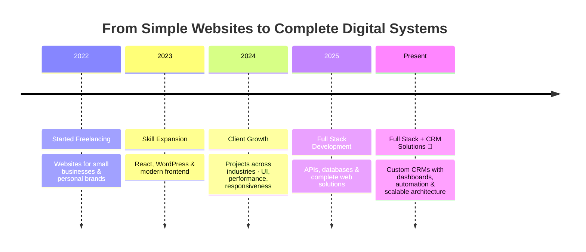

<!-- ═══════════════════════  HEADER  ═══════════════════════ -->
<p align="center">
  
</p>

<p align="center">
  <a href="https://amreshprajapati.com/">
    
  </a>
</p>

<p align="center">
  <a href="https://amreshprajapati.com/"></a>
  <a href="mailto:info@amreshprajapati.com"></a>
  
</p>

<p align="center">
  <a href="https://www.instagram.com/amreshprajapatiwebdevloper/"></a>
  <a href="https://www.facebook.com/amreshprajapatiwebdevloper"></a>
  <a href="https://wa.me/919004068462"></a>
  <a href="https://amreshprajapati.com/"></a>
  <a href="mailto:info@amreshprajapati.com"></a>
</p>

<br/>

<!-- ═══════════════════════  ABOUT  ═══════════════════════ -->
##  About Me

<table>
<tr>
<td width="58%" valign="top">

> *"Every great design begins with an even better story."*

I'm **Amresh Prajapati**, a passionate **Freelance Website Developer** from **Mumbai, India 🇮🇳**.  
I design and build **modern, fast, responsive and SEO‑ready websites** for businesses, startups, personal brands and agencies — with clean UI, strong performance and premium visual impact.

My focus isn't just making a website *look* good. I build websites that **load fast, feel premium, work smoothly on mobile and help users take action.**

```js
const amresh = {
  location:    "📍 Mumbai, Maharashtra, India",
  role:        "Full Stack Website Developer & UI/UX Designer",
  experience:  "4+ Years (Freelancing since 2022)",
  code:        ["HTML", "CSS", "JavaScript", "React", "Node.js", "PHP"],
  cms:         ["WordPress"],
  design:      ["Figma", "Canva", "Photoshop"],
  currentFocus:"Full Stack Apps + Custom CRM Solutions 🚀",
  funFact:     "I also design eye‑catching product packaging 📦",
  askMeAbout:  ["React", "WordPress", "SEO", "UI/UX", "Hosting"],
  available:   true // 👉 Open for freelance projects!
};
```

</td>
<td width="42%" valign="top" align="center">


</td>
</tr>
</table>

<!-- ═══════════════════════  NUMBERS  ═══════════════════════ -->
## 🏆 Impact in Numbers

<p align="center">
  
  
  
  
  
</p>

<!-- ═══════════════════════  SERVICES  ═══════════════════════ -->
## 💼 What I Do

<table align="center">
<tr>
<td align="center" width="25%">
<br/>
<b>Website Design</b><br/>
<sub>Modern UI designs in Figma & Canva with a clean visual strategy</sub><br/><br/>
<code>20+ Projects</code>
</td>
<td align="center" width="25%">
<br/>
<b>Development</b><br/>
<sub>Fast, responsive, production‑ready sites in React & WordPress</sub><br/><br/>
<code>15+ Projects</code>
</td>
<td align="center" width="25%">
<br/>
<b>SEO / Marketing</b><br/>
<sub>Better search visibility, speed, structure & engagement</sub><br/><br/>
<code>8+ Projects</code>
</td>
<td align="center" width="25%">
<br/>
<b>Packaging Design</b><br/>
<sub>Custom, eye‑catching packaging that makes products stand out</sub><br/><br/>
<code>25+ Projects</code>
</td>
</tr>
</table>

✅ Clean & professional design &nbsp;•&nbsp; ✅ Responsive on all devices &nbsp;•&nbsp; ✅ Fast loading &nbsp;•&nbsp; ✅ SEO‑friendly structure &nbsp;•&nbsp; ✅ Transparent communication &nbsp;•&nbsp; ✅ Long‑term support

<!-- ═══════════════════════  TECH STACK  ═══════════════════════ -->
## 🛠️ Tech Stack & Tools

<p align="center">
  <a href="https://skillicons.dev">
    
  </a>
  <br/><br/>
  <a href="https://skillicons.dev">
    
  </a>
</p>

<details>
<summary><b>📊 Click to see my skill levels</b></summary>
<br/>

| Skill | Level |
|:--|:--|
|  | `██████████████████▍░` **92%** |
|  | `█████████████████░░░` **85%** |
|  | `███████████████████░` **95%** |
|  | `██████████████████░░` **90%** |
|  | `███████████████████░` **95%** |
|  | `████████████████░░░░` **80%** |
|  | `█████████████▊░░░░░░` **69%** |
|  | `████████████████░░░░` **80%** |

</details>

<!-- ═══════════════════════  PROJECTS  ═══════════════════════ -->
## 🚀 Featured Projects

<table>
<tr>
<td width="50%" valign="top">

### ☀️ Complete Energy Group
**Solar Solutions Website**

A conversion‑focused website for solar products, batteries and EV solutions — built with custom React JS code.


</td>
<td width="50%" valign="top">

### 🎨 Stella Designs
**Creative Studio Website**

A modern website for a 360° design studio focused on wall graphics, signage and placemaking — coded entirely in React JS.


</td>
</tr>
</table>

<p align="center">
  <a href="https://amreshprajapati.com/"></a>
</p>

<!-- ═══════════════════════  JOURNEY  ═══════════════════════ -->
## 🧭 My Journey



<!-- ═══════════════════════  GITHUB STATS  ═══════════════════════ -->
## 📈 GitHub Analytics

<p align="center">
  
  
</p>

<p align="center">
  
</p>

<p align="center">
  
</p>

<p align="center">
  
</p>

<!-- Snake animation: works after adding .github/workflows/snake.yml (see setup notes) -->
<p align="center">
  <picture>
    <source media="(prefers-color-scheme: dark)" srcset="https://raw.githubusercontent.com/amreshpr/amreshpr/output/github-snake-dark.svg" />
    
  </picture>
</p>

<!-- ═══════════════════════  TESTIMONIALS  ═══════════════════════ -->
## 💬 What Clients Say

<table>
<tr>
<td width="33%" valign="top">

⭐⭐⭐⭐⭐  
*"Great work! The website interface is exactly what I had in mind. Really appreciate the new animation you added."*  
— **Pankaj Kumawat**

</td>
<td width="33%" valign="top">

⭐⭐⭐⭐⭐  
*"Good service. Had a great experience and got my website as expected and on time."*  
— **Shree Krishna**

</td>
<td width="33%" valign="top">

⭐⭐⭐⭐⭐  
*"Professional and reliable developer. Delivered the project within the deadline with great quality."*  
— **Shruti Ghelani**

</td>
</tr>
</table>

<!-- ═══════════════════════  CTA  ═══════════════════════ -->
## 🤝 Let's Work Together!

<p align="center">
  <b>Have a website idea? Let's build it together.</b><br/>
  Business Website • Portfolio • Landing Page • WordPress • Custom React • SEO • Domain & Hosting • Packaging Design
</p>

<p align="center">
  <a href="https://amreshprajapati.com/"></a>
  <a href="mailto:info@amreshprajapati.com"></a>
  <a href="https://wa.me/919004068462"></a>
</p>

<p align="center">
  
</p>

<!-- ═══════════════════════  FOOTER  ═══════════════════════ -->
<p align="center">
  
</p>
